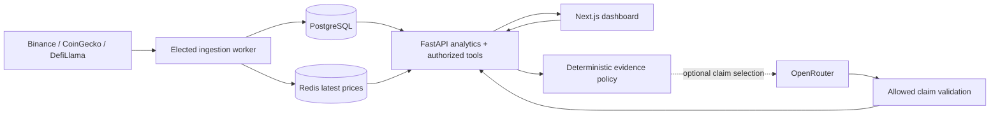

# CryptoLens AI — public portfolio

A local cryptocurrency research terminal with public market ingestion, deterministic historical risk analytics, and a bounded, evidence-backed AI analyst. No trading, wallet signing, exchange credentials, or promises of future performance.

This repository is a reviewed source snapshot for portfolio inspection and local use.
It includes the application, tests, migrations, deployment tooling and technical documentation.
Private Git history, credentials, databases, captured conversations, screenshots and operational
reports are excluded. See [publication review](docs/PUBLICATION_REVIEW.md).

The public source release does not deploy a public service. If another checkout already runs
the `cryptolens` Compose project, stop here: both checkouts target the same project and volumes.
Use the existing checkout for operations; do not launch both copies on the same Docker daemon.

## Run

Requires Docker Compose. Copy `.env.example` to `.env`, choose a local PostgreSQL password in both database settings, and set file permissions to `600`. The checked-in password is a development placeholder, never a deployment secret.

```bash
cp .env.example .env
chmod 600 .env
# Edit DATABASE_URL and POSTGRES_PASSWORD consistently.
docker compose up -d --build
curl -fsS http://localhost:8100/api/v1/health/ready
```

Open [dashboard](http://localhost:3100) and [API documentation](http://localhost:8100/docs). The migration service runs before the API and worker. PostgreSQL and Redis have no host ports. The app uses dedicated loopback ports 3100 and 8100.

For deterministic offline operation set `DATA_MODE=fixture` and recreate the API and worker. Fixtures are synthetic, use a fixed date, and are visibly labeled. They are never silently substituted for unavailable live data.

Research is disabled by default. Set `AI_ENABLED=true` for deterministic grounded reports without external inference. Optional `AI_NARRATION=true` lets the configured model select approved claim IDs and requires `OPENROUTER_API_KEY` only in the backend environment. Local environment files are ignored by Git. Do not put credentials in `NEXT_PUBLIC_*` settings.

## Features

- Explicit ten-asset identity registry with cross-provider IDs and a separate stablecoin flag.
- Binance finalized daily/hourly candles, paginated multi-year backfill, multiplexed live kline feed, latest-value Redis delivery, reconnect/backoff and planned connection rotation.
- CoinGecko metadata archives, global aggregates and configurable paginated market discovery; DefiLlama chain/protocol metrics and reviewed Aave mapping.
- Returns, drawdown, sample volatility, historical VaR/CVaR, downside deviation, optional risk-free Sharpe/Sortino, aligned correlation and rolling volatility.
- Deterministic balanced, volatility, drawdown, liquidity and explicit-risk-free Sharpe ranking with coverage gates, exclusion reasons and stablecoin separation.
- Search, sorting, local watchlist, candlestick detail, fundamental metrics, comparison matrix, risk controls and responsive dark UI.
- English/Indonesian AI requests, bounded allowlisted tools, compact context, evidence-backed numerical findings, validated dataset chart references, validated-text SSE, cancellation, account/session ownership and deletion.
- Scrypt accounts, CSRF/roles, durable token/idempotency admission, elected ingestion ownership, metrics and correlated spans.
- RSI/SMA/EMA/MACD with explicit warm-up, hourly views, DeFi research and virtualized provider discovery.
- Digest-pinned Docker images, local TLS, API promotion/rollback, verified backup restore, Redis recovery checks and CI.

## Architecture



Python 3.13, FastAPI, Pydantic, SQLAlchemy/Alembic, NumPy/Polars, PostgreSQL 16, Redis 7, Next.js 16.4.3, React 19.3.1, TypeScript, TanStack Query, Zod, Recharts and Lightweight Charts. Exact resolved dependencies are in the lockfiles. See [technology decisions](docs/TECH_STACK.md).

## Development and verification

```bash
python3.13 -m venv .venv
.venv/bin/pip install -r backend/requirements.lock
(cd backend && ../.venv/bin/ruff check . && ../.venv/bin/mypy app && ../.venv/bin/pytest -q)
(cd frontend && npm ci && npm run lint && npm run build && npm run typecheck && npm run test)
(cd frontend && npx playwright install chromium && npm run e2e)
python3 scripts/benchmark.py
docker compose exec -T backend alembic check
```

Backend tests always use a temporary isolated SQLite database, never the application's database. CI separately checks PostgreSQL migrations and the full fixture-mode Compose stack. Playwright stubs the paid AI endpoint; live evaluations are explicit opt-in and share the same persistent budget.

## Operations

```bash
docker compose ps
docker compose logs --tail 100 backend ingestion-worker
docker compose stop                     # preserves data
docker compose start
docker compose down                     # removes only this project's containers/network
```

Never run `down -v` as a normal operation. Read [deployment](docs/DEPLOYMENT.md) for backup/recovery and [security](docs/SECURITY.md) before exposing any service beyond localhost.

## Scope and limits

This is a functioning local research application, not a public multi-tenant financial service. Daily risk statistics use Binance **USDT** candles; CoinGecko metadata uses **USD**. These quotes are labeled separately. Data may be delayed, incomplete or wrong. Analytics cover ten reviewed assets and up to 1,826 daily returns when history is available. Discovery captures up to 1,000 provider assets by default, configurable to 20,000; it is not a complete-market guarantee.

Numerical findings are copied from backend evidence. Default prose is assembled from approved
claims whose predicates and freshness are checked by the backend. An optional model can select
claim IDs; it cannot supply displayed prose or numbers. Unknown/ambiguous requests are clarified
or refused by bounded rules. The known golden-set regression is not general model intelligence
or independent human quality review. Synthetic and stale observations remain labeled.

The account-protected [local HTTPS package](docs/DEPLOYMENT.md) exposes only localhost:8443
and includes an API rollback rehearsal. Public hosting, independent penetration testing and
external quality review are outside the user's local-only deployment scope. See
[the public checkpoint](CHECKPOINT.md) for verification scope.

See [verification evidence](docs/VERIFICATION.md), [AI evaluation](docs/AI_EVALUATION.md), [publication scope](docs/PUBLICATION_REVIEW.md), and the [implementation log](docs/IMPLEMENTATION_LOG.md). No accuracy or investment-performance benchmark is claimed.
