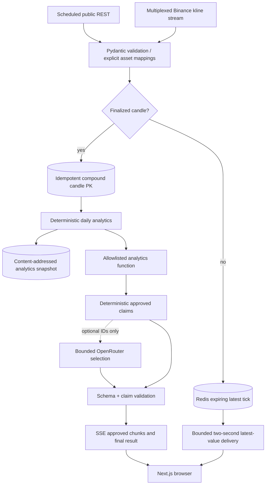
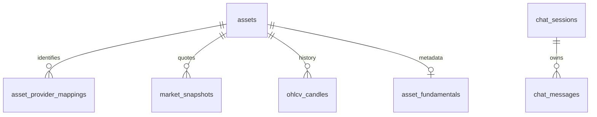

# Architecture

A modular monolith, with API and ingestion in separate processes. Provider network operations are asynchronous. Synchronous SQLAlchemy and numerical workloads run in FastAPI worker threads or `asyncio.to_thread`; they do not run directly on the API event loop. A dedicated PostgreSQL session advisory lock elects one ingestion owner; standby workers wait. A two-second session heartbeat cancels owner tasks on connection loss.

Provider failures leave the last successful snapshot available with age metadata. Redis outage degrades ordinary REST to PostgreSQL, closes market streams and blocks costly AI admission. Database outage makes readiness fail. Slow WebSocket consumers are disconnected after a send timeout; only latest prices are polled, never an unbounded tick queue. AI cancellation cancels in-flight network work, but an already-dispatched provider may still bill it, so unknown usage stays reserved.

Component boundaries: `providers.py` owns external contracts; `worker.py` schedules/persists; `registry.py` owns identity; `analytics.py` owns pure math; `services.py` owns authorized queries; `ai.py` owns budget/provider calls, `research_policy.py` owns grounded reports, `admission.py` owns durable single-flight/idempotency, `auth.py` owns accounts, `leadership.py` owns ingestion coordination, `telemetry.py` owns metrics/spans; `main.py` owns API/session/streaming boundaries; `db.py` owns persistence.

Account sessions and AI admission are shared in PostgreSQL; the local package includes a bounded multi-user test and an API replica switch. More replicas still need workload-specific capacity testing and per-process metric scraping. Current data bounds and user concurrency favor PostgreSQL indexes and Redis over Kafka/Celery/Kubernetes. No distributed workflow engine is required.
